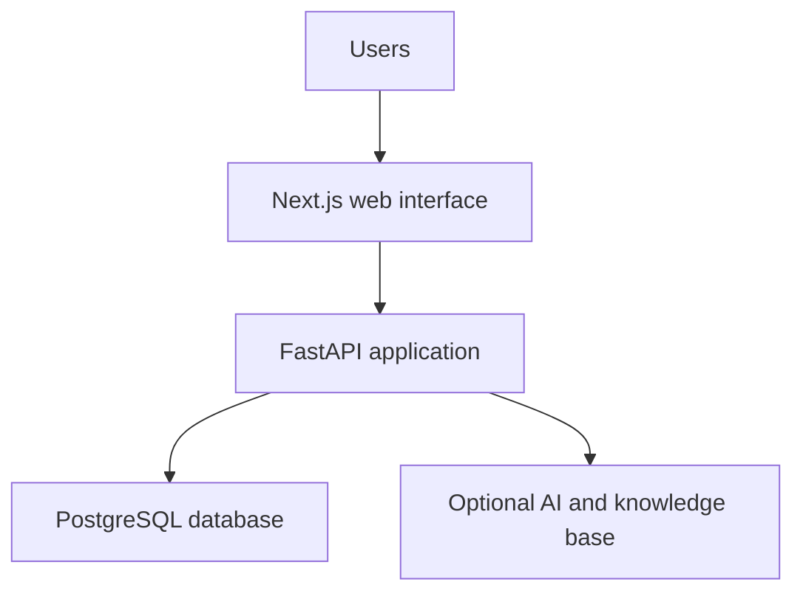

# Waseet | وسيط

### Complaint & Request Management System

An academic MIS graduation project that brings complaint submission, assignment, status tracking, and service-level monitoring into one web application.

Waseet connects the user-facing request journey with the operational tools used by agents, managers, and administrators. The repository contains the web interface, API, database migrations, and container configuration.

## The business problem

Requests spread across separate channels can make ownership, follow-up, and resolution status difficult to track. Waseet explores a centralized workflow with defined user roles, access permissions, and operational reporting.

## My contribution — Albaraa Alhejaili

This was a team graduation project at Taibah University. My contributions included application code, web interface development and design, role and permission workflows, and project reporting and documentation. These contributions combine hands-on implementation with an understanding of business processes and system requirements.

The repository presents the team's system; it does not attribute the entire codebase to one contributor.

## Functional areas

| Area | Purpose |
|---|---|
| Complaint and request management | Submit requests, view details, and follow their progress |
| Operational queues | Organize work by assigned agent and department |
| Roles and permissions | Control access for requesters, agents, managers, and administrators |
| SLA management | Represent service targets and track overdue work |
| Reporting | Provide operational views for follow-up |
| Knowledge base and AI | Optional document-based assistance through configured AI services |
| Administration | Manage users, departments, categories, and documents |

## Technology

- **Frontend:** Next.js, React, TypeScript, Tailwind CSS, Recharts.
- **Backend:** Python, FastAPI, SQLAlchemy, Alembic.
- **Database:** PostgreSQL and pgvector in the container setup.
- **Authentication:** JWT with role and permission checks.
- **Optional AI:** OpenAI integrations and knowledge-base components.
- **Environment:** Docker Compose.

## Architecture



## Run locally

Prerequisite: Docker with Docker Compose.

1. Copy `.env.example` to `.env` (`cp .env.example .env` in a Unix shell, or `Copy-Item .env.example .env` in PowerShell).
2. Set your local database password and signing secret in `.env`. Keep AI disabled for an initial non-AI run. Keep this file out of Git.
3. From the repository root, run:

```sh
docker compose up -d --build
docker compose exec backend alembic upgrade head
docker compose exec backend python -m app.seed
```

4. Open the application at `http://localhost:3000`. API documentation is at `http://localhost:8000/docs`; the service health endpoint is `http://localhost:8000/health`.

The seed script creates demonstration accounts. See [original setup instructions](docs/SETUP_ORIGINAL.md) for their details and additional configuration. Demo accounts are intended for local evaluation.

## Optional AI configuration

AI functionality requires separate provider credentials and configuration. Refer to `.env.example`, `backend/app/core/config.py`, and the original setup instructions. Cloud knowledge-base features may also require a configured vector store. The non-AI application can be evaluated without enabling these features.

## Repository guide

| Path | Content |
|---|---|
| `frontend/src/app/` | Pages, layouts, and application screens |
| `frontend/src/components/` | Shared interface components |
| `backend/app/routers/` | API routes |
| `backend/app/core/` | Configuration, authentication dependencies, and workflow logic |
| `backend/app/models/` | Database entities |
| `backend/app/services/` | Application services |
| `backend/alembic/` | Schema migrations |
| `infra/` | Database and reverse-proxy configuration |

## Verification status

The source archive was checked for integrity and its 45 Python files passed syntax parsing during portfolio preparation. A full container build and end-to-end run have not yet been verified in the preparation environment. No claim of production readiness is made.

Local database files and generated uploads are excluded from this portfolio copy. Use the included migrations and seed script to create demonstration data.

## نبذة بالعربية

وسيط مشروع تخرج جماعي في نظم المعلومات الإدارية بجامعة طيبة، يهدف إلى تنظيم الشكاوى والطلبات ومتابعتها من خلال واجهة موحّدة وأدوار وصلاحيات محددة. شملت مساهمتي تطوير أجزاء من التطبيق وواجهات الويب وتصميمها، والعمل على منطق الأدوار والصلاحيات، وإعداد التقرير والتوثيق. يوضح المشروع الصلة بين احتياجات العمل وتصميم النظام وتنفيذه.
